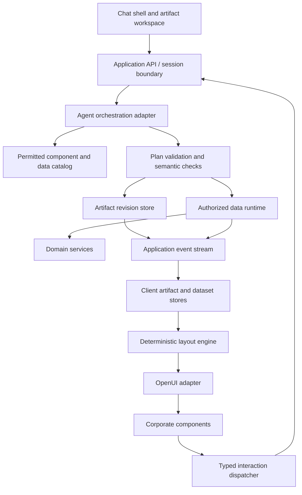

# Corporate Chatbot UI Framework — Implementation Design

**Status:** Proposed implementation specification, not an implemented or runtime-validated system  
**Date:** 2026-11-14  
**Audience:** Application engineers, frontend engineers, platform engineers, designers, security reviewers  
**Working name:** Corporate Chat UI  
**Primary rendering candidate:** OpenUI

## 1. Executive decision

Build a small, opinionated React/TypeScript framework that allows an LLM-backed agent to select approved visual components and bind them to authorized business datasets. Use OpenUI behind an adapter to render the selected components. Enforce appearance and layout through a corporate component library, design tokens, and deterministic layout rules.

**Product clarification, 2026-11-14:** The product is a full-screen chatbot, with a conversation-first experience like ChatGPT. The agent dynamically creates charts, tables, metrics and other approved components **inside assistant message bubbles** when useful. A multi-panel dashboard is one possible response within the conversation, not the application shell or a permanent companion pane.

**A visual response contains between one and six content panels. The count is dynamic, not a fixed six-slot dashboard.** A request for a trend can produce one chart. A broader investigation can produce a chart and table. A management overview can produce six complementary panels. Do not add filler panels to satisfy a template. Ordinary text-only answers remain supported and contain no visual artifact.

Use the same artifact model for a single chart and a multi-panel dashboard. This avoids separate implementations when a user expands a simple answer through follow-up questions.

The agent owns semantic choices: which measures answer the question, which allowed component to use, and which panels to add or replace. The application owns data access, validation, layout, typography, interaction execution, persistence, and recovery.

For the first implementation, use a typed dashboard plan as the authoritative application contract and compile each approved panel to OpenUI through one adapter. This deliberately favors validation and portability over unconstrained OpenUI generation. Section 5 explains the tradeoff and the adoption gate.

## 2. Goals, scope, and assumptions

### 2.1 Goals

1. Let engineers add a corporate chatbot to an existing application without rebuilding chat, visualization, layout, and security plumbing.
2. Let agents choose and combine charts, tables, metrics, and bounded relationship graphs during conversation.
3. Support all panel counts from one through six with readable, responsive, Swiss-grid-inspired presentation.
4. Keep numerical results grounded in trusted computation and traceable source data.
5. Support follow-up edits, filters, drill-downs, refresh, and restoration without unnecessary LLM calls.
6. Provide stable extension contracts and a useful starter application.
7. Fail locally and visibly: one failed panel must not blank the entire response.

### 2.2 Initial scope

The first release is a read-only analytics framework. It includes conversation streaming, visual artifacts, metric cards, trend/comparison charts, tables, a bounded relationship graph, shared filters, panel detail views, persistence, and instrumentation. Domain-specific tools supply the data.

Business mutations, arbitrary user-authored code, freeform dashboard design, unrestricted SQL, scheduled reports, real-time collaboration, and a full BI semantic layer are outside the first release. Export can follow the read-only core once authorization and snapshot semantics are established.

### 2.3 Assumptions

- React/TypeScript is the reference frontend; backend transport and agent orchestration remain replaceable.
- An application supplies identity, approved data tools, and business metric definitions.
- One tenant may contain multiple teams with different data entitlements.
- Desktop is the main dashboard surface, but narrow windows and mobile must remain usable.
- The six-panel cap applies to each visual artifact, including metric cards. Filters, titles, legends, tooltips, and source footers are controls or decoration, not extra panels.
- The first release permits one new or updated visual artifact per assistant turn. A conversation may contain many artifacts over time.
- A detail drawer shows the selected panel's supporting information; it is not a loophole for adding unlimited overview panels.
- The existing `sample_data` file is not used or assumed to have any particular business meaning. The example in this design is synthetic.

## 3. Functional requirements and invariants

| ID | Requirement | Observable acceptance condition |
|---|---|---|
| FR-01 | Dynamic panel count | Valid plans with 1, 2, 3, 4, 5, and 6 panels render; 0 and 7 are rejected for visual artifacts |
| FR-02 | Appropriate simplicity | A one-trend question produces one chart unless the user requests supporting content |
| FR-03 | Curated components | Only registered component types and approved configuration values render |
| FR-04 | Data grounding | Every visual measure binds to an authorized dataset field; no model-authored numerical series |
| FR-05 | Consistent layout | Same plan, registry version, and container width produce the same placement |
| FR-06 | Stable edits | Unchanged panel IDs, compatible filters, and table state survive a follow-up edit |
| FR-07 | Local interactions | Sort, paginate, filter, and refresh do not require an LLM |
| FR-08 | Resilience | Loading, empty, stale, forbidden, and error states are independently visible |
| FR-09 | Persistence | A saved revision reopens with its declared snapshot or live semantics |
| FR-10 | Access control | All reads and interactions are authorized on the server, including cache hits |
| FR-11 | Extension | A domain team adds a tool and optional panel without modifying framework internals |
| FR-12 | Accessibility | Controls are keyboard operable and visualizations expose equivalent textual information |

Non-negotiable invariants:

- Never interpret model output as executable browser code.
- Never trust model-provided user IDs, tenant IDs, permissions, URLs, or dataset ownership.
- Never execute data tools merely because an incomplete UI stream references them.
- Never silently truncate a seven-panel proposal into six; repair the plan or explain the limit.
- Never replace an existing valid artifact with an invalid candidate revision.
- Never present mixed filter generations as a coherent completed dashboard.
- Never infer causality from a correlation chart or fabricate missing values.

## 4. User experience

### 4.1 Full-screen conversation and visual message bubbles

The conversation occupies the application surface. Use a full-width transcript with a readable centered content column, user and assistant message bubbles, and a composer anchored at the bottom. Text-only answers create no blank visual placeholder. Render all approved visual responses, including a six-panel overview, inside the assistant bubble that produced them. Do not use a split chat/dashboard shell or move larger responses into a separate workspace by default.

Each visual response references its own artifact revision. A follow-up produces a new assistant bubble with the updated revision; earlier bubbles retain their historical visualizations and do not silently change to the latest plan. Restore these message/revision associations after reload. Keep filters, record details and other controls with their response. Historical revisions are read-only except for inspecting underlying values/authorized record details. A future explicit enlargement affordance may aid inspection, but must preserve conversation context and is not the primary layout. On mobile, panels stack inside the same bubble.

Each visual artifact displays a title, active filter summary, data freshness, refresh control, and revision context. Each panel has a title, units where relevant, loading/error state, and access to source details. Keep implementation diagnostics out of the product UI.

### 4.2 Panel count and expansion

Default to the smallest set that answers the request. The agent can propose more panels when the user asks for comparison, supporting records, or a broader overview. Adding a panel triggers a new validated layout; loading data must not cause that layout to keep changing.

If six panels already exist, a request for another panel requires replacing an identified panel, creating a separate artifact in a subsequent turn, or asking which panel to replace. Do not hide excess panels behind tabs while claiming to enforce a six-panel artifact limit.

### 4.3 Follow-up behavior

- “Add the underlying records” appends a table if capacity permits.
- “Use a bar chart instead” replaces the selected or unambiguously referenced panel while preserving its ID when its semantic identity is unchanged.
- “Only show Team A” updates a supported shared filter, rather than regenerating the UI.
- “Explain that spike” can invoke the agent with the selected point's bounded, authorized context.
- If “that chart” is ambiguous, use explicit selection context or ask a concise clarification.

Editing should preserve user focus. Announce completed updates through a polite live region. Do not move focus simply because a chart finishes loading.

## 5. OpenUI integration strategy

### 5.1 Verified capabilities and limits

OpenUI documents custom React component definitions using schemas, library construction, and component extension. Its renderer accepts OpenUI content and maps it to the supplied library. These are the relevant integration points, not guarantees of corporate authorization or analytical correctness. [Component definitions](https://www.openui.com/docs/openui-lang/defining-components)

The renderer documents structured errors and progressive parsing. Unresolved references can be removed from arrays while streaming, so the application must reserve its own panel slots to guarantee a stable grid. [Renderer](https://www.openui.com/docs/openui-lang/renderer)

The hosted dashboard product is a separate adoption choice: the documented client uses a Thesys API key and hosted API origin. Do not assume this is required for using the rendering packages. [Dashboard authentication](https://www.openui.com/docs/dashboards/authentication)

### 5.2 Authoritative contract

Use a **typed UI plan** generated through the agent's structured-output or tool-call interface. The backend validates it and assigns dataset handles, revision IDs, and execution context. This plan is the source of truth.

The OpenUI adapter deterministically converts each approved panel into a small OpenUI program that references a registered corporate component. The outer dashboard grid belongs to the framework. A dataset provider resolves binding IDs for the component; business rows are not embedded in generated OpenUI text.

The UI plan is a narrow domain contract with six or fewer flat panels. It is not a general UI language: it has no arbitrary nesting, expressions, scripts, styles, or layout coordinates. Do not maintain independently editable JSON and OpenUI versions. Generated OpenUI is a disposable rendering artifact, optionally retained for diagnostics.

This architecture still gives the agent control of component selection, configuration, order, and composition. It does not use OpenUI's direct model-language streaming or claimed language token savings in the first release. A direct React renderer would also be feasible; OpenUI must demonstrate useful integration value rather than becoming a mandatory dependency without benefit.

### 5.3 Adoption spike and fallback

Before building the full shell, verify:

1. Register one data-bound chart and table in the selected OpenUI package version.
2. Compile strings, Unicode, quotes, and optional arguments safely with a serializer; never raw string concatenation.
3. Resolve data through application context without giving the renderer general-purpose tools.
4. Mount one to six independent panel renderers inside a stable CSS grid.
5. Verify state preservation, remount behavior, errors, accessibility, and bundle cost.
6. Prove the adapter does not invoke arbitrary query/mutation expressions.

Use the same flat plan with direct React rendering if the spike demonstrates that OpenUI adds unacceptable restrictions or overhead. Document that decision. A later direct-OpenUI generation mode must decode into and pass the same policy checks before mounting; it is not a shortcut around the plan contract.

### 5.4 Dependency policy

Pin verified package versions and retain a lockfile. Record the component catalog and adapter versions with each artifact. Recheck upstream APIs during the spike; the examples in this document describe proposed application interfaces, not guaranteed upstream exports. Hosted repair, telemetry, and generation services are opt-in deployment decisions.

## 6. System architecture and module boundaries



| Module | Owns | Does not own |
|---|---|---|
| `contracts` | Plan schemas, dataset metadata, event and action contracts | React or provider SDKs |
| `catalog` | Component capabilities, permitted bindings, examples | User authorization decisions |
| `ui-kit` | Tokens, panel chrome, charts, tables, graph wrappers | Tool execution |
| `layout` | Template selection, spans, breakpoint behavior | Model prompting |
| `renderer-openui` | Compilation, library registration, render errors | Dashboard persistence or permissions |
| `client-runtime` | Artifact state, dataset cache, interaction generations | Server-side credentials |
| `server-runtime` | Validation, authorization hooks, query coordination, revisions | A mandatory agent framework |
| `agent-adapter` | Prompt assembly, tool schemas, structured plan requests | Rendering and business calculations |
| `chat-shell` | Transcript, composer, workspace, navigation | Domain-specific data models |
| `testing` | Fixtures, contract harness, replay and evaluation utilities | Production data |

Keep this as a modular monorepo initially, not a collection of separately deployed microservices. Start with one application backend and one persistence store. Interfaces permit later separation if operational scale requires it.

## 7. Contracts and data model

### 7.1 Artifact plan

The following is illustrative TypeScript. Implement runtime validation using the shared schema definitions; TypeScript types alone do not validate model or network input.

```ts
type ComponentType =
  | 'metric' | 'trend' | 'comparison' | 'table' | 'relationship';

type PanelSpec = {
  id: string;                    // stable within an artifact
  component: ComponentType;
  componentVersion: 1;
  title: string;
  bindingId: string;
  importance: 'primary' | 'supporting';
  config: PanelConfig;           // discriminated union by component
};

type ArtifactPlan = {
  schemaVersion: 1;
  title: string;
  layoutIntent: 'auto' | 'overview' | 'comparison' | 'investigation';
  panels: PanelSpec[];           // runtime min 1, max 6, unique IDs
  bindings: DataBinding[];
  filters: FilterDefinition[];
  dataMode: 'snapshot' | 'live';
};

type StoredArtifact = {
  artifactId: string;
  revision: number;
  catalogVersion: string;
  adapterVersion: string;
  plan: ArtifactPlan;
  createdAt: string;
  sourceMessageId: string;
  snapshotId?: string;
};
```

Ownership, tenant, ACL, and policy metadata are server-controlled persistence fields, omitted from model output and sanitized client payloads. Reject unknown fields, excessive lengths, invalid IDs, duplicate panels, unused or inaccessible bindings, and incompatible component configurations.

`PanelConfig` must be a real discriminated schema, not `Record<string, any>`. Example configurations:

| Type | Required configuration | Restrictions |
|---|---|---|
| Metric | `valueField`, `format` | Exactly one aggregate result; format agrees with unit |
| Trend | `xField`, `yField` | Temporal x, numeric y; optional bounded series field |
| Comparison | `categoryField`, `valueField` | Bounded categories; approved ordering; zero baseline by default |
| Table | Ordered `columns` | Authorized fields only; server pagination for large results |
| Relationship | `nodeIdField`, `sourceField`, `targetField` | Valid endpoints, bounded nodes/edges, registered layout mode |

### 7.2 Data binding and metadata

```ts
type DataBinding = {
  id: string;
  toolId: string;                // catalog entry, never an arbitrary URL
  args: Record<string, unknown>; // validated with the selected tool's schema
  filterMap: Record<string, string>; // approved filter ID -> tool argument
};

type DatasetMetadata = {
  handle: string;                // server-issued reference, not a credential
  bindingId: string;
  fields: Array<{
    name: string;
    type: 'string' | 'number' | 'boolean' | 'date' | 'datetime';
    nullable: boolean;
    unit?: string;
    metricDefinitionId?: string;
  }>;
  asOf: string;
  timezone: string;
  provenance: { sourceId: string; queryVersion: string };
  truncated: boolean;
};
```

Add explicit currency, denominator, valid aggregation, and categorical domain metadata where relevant. Missing values remain missing; zero is a real value. Distinguish an empty successful query from an unavailable source. Result envelopes carry pagination cursors and warnings separately from rows.

Tool arguments can be proposed by the agent, but the runtime injects authorization context independently. No raw SQL or arbitrary transforms in the first release. A domain tool may perform a reviewed aggregation, join, or metric calculation.

Filter definitions are also typed. The initial `select` contract contains `id`, `type: 'select'`, `label`, an allowlisted `optionsSource`, and a scalar or null `defaultValue`. Add separate discriminated contracts for date ranges and multi-selects when implemented. An options source is an authorized application catalog resolver, not a URL or an arbitrary model-created tool. It must return only permitted values and safe labels. A null team selection means all teams the current user may access, never all teams in the database.

Generate controls from the question, not a mandatory dashboard template. Keep named domain, country, system and time constraints in binding arguments by default. For example, “payment's data quality trend in 2024” has fixed payment/2024 scope and no domain dropdown. Add a selector only when the user requests interaction on that dimension; resolve its options within all other fixed constraints. The renderer reads only the validated plan's filter definitions and must not hardcode a domain control. In the CSV reference domain, broad “data quality” means three separate trends (`avg_comp`, `data_ctrl_score`, `sla_met_rate`) per the user's clarification; a specifically named measure narrows that response.

Validate each `filterMap` against the tool argument schema, including type compatibility. Only declared arguments may be overridden by filters; identity and tenant context are never filterable. Define precedence explicitly: validated active filter values override corresponding plan arguments, while other arguments retain their validated defaults. Reject conflicting or invalid values rather than silently broadening the query.

### 7.3 Component registration

Each registration supplies an ID/version, input schema, renderer, description, usage examples, required field roles, allowed actions, minimum readable width, height class, accessibility description, and loading/empty/error representations.

The same registration should drive validation, prompt descriptions, adapter compilation, and developer documentation. Avoid four manually maintained copies of a component's contract. Only include the components and tools relevant to the current use case in the model context.

### 7.4 Versioned edits

Edit requests include `artifactId`, `baseRevision`, and domain operations such as `addPanel`, `replacePanel`, `removePanel`, `setTitle`, and `setFilterDefinition`. Operations cannot alter ownership or permissions. Validate the complete resulting plan before committing it.

Use optimistic concurrency: if the base revision is no longer current, return a conflict and reload or replan. Do not silently overwrite newer edits. Treat a removal resulting in zero panels as invalid; deleting an artifact is a separate explicit operation.

## 8. Adaptive layout for one to six panels

### 8.1 Layout inputs

Layout is a pure function of validated panels, intent, component capabilities, token version, and artifact container width. It does not depend on arrival order, random packing, or the number of loaded rows.

Use a 12-column grid on wide containers, a two-column presentation on medium containers where minimum widths permit it, and a single column on narrow containers. Suggested initial thresholds are 1200px for wide and 768px for medium; test actual card widths before finalizing them.

Minimum width outranks the breakpoint. For example, three chart columns may still be unsuitable in a nominally wide workspace. Tables and graphs often require full width. A metric may use a narrower slot than a chart.

### 8.2 Count-aware default compositions

| Panels | Default wide-container composition | Content-specific adjustment |
|---|---|---|
| 1 | One 12-column panel | Metric remains compact inside a spacious content region; chart gets useful width |
| 2 | 6 + 6 | Use 12 / 12 if either component cannot fit side by side |
| 3 | 6 + 6 / 12 | Use 4 + 4 + 4 only for three compact compatible panels; primary panel may go first full-width |
| 4 | 6 + 6 / 6 + 6 | A wide table produces additional full-width rows |
| 5 | 6 + 6 / 6 + 6 / 12 | Three metrics plus two charts may use 4 + 4 + 4 / 6 + 6 |
| 6 | 6 + 6 / 6 + 6 / 6 + 6 | Overview: 4 + 4 + 4 / 6 + 6 / 12 for three metrics, two charts, one table |

`/` separates rows. These are preferences, not a command to shrink every chart to fit. When a requested intent is incompatible, choose the closest valid layout deterministically. Never silently substitute a different visualization solely to satisfy a template.

### 8.3 Selection algorithm

1. Validate panel count and determine each panel's required width and height class.
2. Select candidates compatible with count, intent, and component roles.
3. Reject candidates violating minimum widths or placing a table/graph in an unsupported slot.
4. Prefer candidates preserving semantic order and an existing valid placement during edits.
5. Use registry-defined priorities to break ties; choose the first stable candidate.
6. Fall back to full-width rows in semantic order when no preferred candidate fits.
7. On narrow containers, retain that reading order in a single column.

Do not use CSS dense packing that changes visual order relative to DOM/keyboard order. Recompute on container resize or a committed structural revision, not on individual dataset completion.

### 8.4 Swiss grid design tokens

| Token family | Initial proposal |
|---|---|
| Spacing | 4, 8, 12, 16, 24, 32, 48px |
| Workspace padding | 24px desktop, 16px narrow |
| Grid gap | 24px wide, 16px medium/narrow |
| Panel padding | 24px normal, 16px compact |
| Typeface | Approved corporate sans-serif; system and CJK fallbacks |
| Type scale | 12px metadata, 14px secondary, 16px body, 20px panel emphasis, 28px artifact title |
| Line height | Approximately 1.4–1.6 for text; explicit chart-label metrics |
| Numerals | Tabular figures, locale-aware formatting |
| Color | Neutral surfaces, one brand accent, semantic status palette |
| Borders | Subtle 1px dividers; restrained radius and shadow |
| Heights | Metric minimum 144px; chart minimum 320px; table minimum 360px; graph minimum 400px |

Heights are minimums, not clipping boxes. Support text zoom and longer translations. Align panel headers, chart plot areas, legends, and footers through shared component chrome. Keep chart palette assignments stable for the same category across panels. Use color plus text, shape, or pattern to convey meaning.

### 8.5 Stable loading

Commit a complete valid plan before allocating slots. Render skeletons matching each panel's height class. Populate data within those slots. A failed panel retains its location and offers a scoped retry. The page does not collapse around a missing component.

## 9. Agent planning and semantic validation

### 9.1 Generation sequence

1. Resolve user/session context and selected artifact/revision.
2. Build a permitted tool and component catalog for the user and domain.
3. Retrieve dataset metadata or bounded authorized summaries when needed.
4. Ask the agent for the smallest sufficient plan or a typed edit.
5. Validate syntax, registry membership, count, field bindings, metric compatibility, filters, and policy.
6. Return concise machine-readable errors for at most one repair attempt by default.
7. Commit a valid plan, schedule authorized data queries, and stream application events.
8. Produce explanatory text grounded in successful query results; omit unsupported conclusions.

The plan can commit before large datasets finish, but field schemas and permissions must already be known. If a tool cannot describe its schema reliably, resolve it before validating the dependent panel.

### 9.2 Selection rules

- Temporal change → trend chart.
- Category comparison → bar chart, typically horizontal for long labels.
- Precise records or many dimensions → table.
- A single aggregate with an agreed definition → metric.
- Actual entity relationships → graph; do not convert arbitrary categories into a network.
- Unclear metric definition or ambiguous business scope → clarification or explicit stated assumption.
- No useful visualization → text response.

Prefer one meaningful panel over redundant variants. Do not use six panels simply because the maximum is six. Limit available styles so the agent does not spend tokens choosing padding or colors.

### 9.3 Repair and fallback

Separate validation errors from source failures. An unknown field may need a plan repair; a timeout needs a query retry. Do not repeatedly ask the model to fix an unavailable database.

If repair fails, retain any existing valid artifact. For a new request, provide a concise text response describing what could be retrieved, or a deterministic authorized table when an existing tool result supports it. Do not fabricate a fallback dataset. Log structured diagnostics without exposing sensitive internals to the user.

## 10. Streaming, state, and interactions

### 10.1 Application event protocol

Use HTTP POST to start work and a fetch-based SSE response or a separate authenticated event endpoint. SSE is the initial choice; bidirectional WebSockets are unnecessary for this scope.

Every event includes `protocolVersion`, `eventId`, `requestId`, and a monotonic sequence. Artifact events additionally carry `artifactId`, `revision`, and, for data, `generationId`.

| Event | Purpose |
|---|---|
| `request.started` | Acknowledge request and correlation ID |
| `assistant.text.delta` | Stream explanation or brief progress |
| `artifact.committed` | Deliver a complete validated plan and revision |
| `dataset.started` | Mark a binding as loading for a generation |
| `dataset.ready` | Deliver bounded data or a handle plus metadata |
| `dataset.failed` | Deliver a safe, typed per-binding failure |
| `artifact.settled` | All required queries reached terminal states; includes partial status |
| `request.completed` | Finish the request |
| `request.failed` | Terminal request failure without destroying prior valid content |

Deduplicate event IDs. Ignore events for superseded revisions/generations. Support bounded replay from the last event ID; when history has expired, fetch the current artifact and request status. Stream closure alone is not proof of successful completion.

### 10.2 State ownership

| State | Owner | Persistence |
|---|---|---|
| Conversation messages | Server | Durable |
| Artifact plan/revision | Server | Durable |
| Dataset snapshot | Server | Retention-policy dependent |
| Shared filters | Client during interaction; server validates requests | Persist when user saves a view |
| Table sorting/page | Client, scoped to panel ID and compatible schema | Optional view preference |
| Hover/tooltips | Component | Ephemeral |
| Query generation | Client and server coordinator | Request lifetime |

### 10.3 Shared-filter consistency

Each filter change creates a new generation and cancels obsolete requests where possible. Deduplicate identical queries. Retain old results with a visible “Updating” state until affected panels can switch together. Unaffected panels remain unchanged.

For a shared-filter group, swap successful results at the generation barrier. If one query fails, show that panel's failure rather than leaving its old numbers looking current. Mark the artifact partially updated. A retry can complete the same logical generation if filter values and revision still match.

Disabling comparison while one panel is updating is preferable to implying that different date ranges are directly comparable. Track source `asOf` separately from UI generation; if a connector cannot provide a consistent source snapshot, expose the difference and document the limitation.

### 10.4 Typed actions

Allow actions such as `setFilter`, `sortTable`, `nextPage`, `openRecord`, `refresh`, and `askAboutSelection`. Validate payloads and resolve record links through trusted application routes. No model-authored navigation URL or callback source code.

The first five are deterministic application operations. `askAboutSelection` is an explicit agent interaction carrying a bounded selection summary and references. If business mutations are later introduced, add separate permission, confirmation, idempotency, and audit contracts before enabling them.

## 11. Backend API and persistence

### 11.1 Suggested endpoints

| Endpoint | Purpose |
|---|---|
| `POST /api/chat/turns` | Start a turn; stream events or return a stream reference |
| `POST /api/requests/:id/cancel` | Best-effort cancellation |
| `GET /api/artifacts/:id?revision=n` | Read a permitted artifact revision |
| `POST /api/artifacts/:id/edits` | Apply a validated edit with base revision |
| `POST /api/artifacts/:id/query` | Resolve approved bindings with validated filters |
| `POST /api/artifacts/:id/actions` | Dispatch a registered interaction |
| `GET /api/requests/:id/events` | Resume an authorized event stream |

Use authenticated sessions, CSRF protection where cookie authentication requires it, bounded request bodies, request cancellation, rate limits, and idempotency keys for retried turn/edit creation. Return stable error codes such as `PLAN_INVALID`, `REVISION_CONFLICT`, `DATA_FORBIDDEN`, `SOURCE_TIMEOUT`, and `SNAPSHOT_EXPIRED`.

### 11.2 Persistence model

Start with relational records for conversations, messages, artifacts, artifact revisions, query executions, and audit events. Store validated plans as versioned JSON documents. Large retained snapshots can move to encrypted object storage, referenced by immutable IDs.

Each artifact has one current revision pointer and immutable prior revisions. Commit the revision and its pointer atomically. Conversation messages reference a particular revision; opening “latest” is an explicit navigation choice.

Cache keys include tenant, effective authorization scope, tool/query version, normalized arguments, source snapshot/freshness policy, and relevant policy epoch. Do not share cache entries across authorization boundaries. Reauthorize on retrieval even when a cache entry exists. Expired or revoked access must also invalidate visible client data.

### 11.3 Live and snapshot modes

Snapshot mode preserves the result context used for the answer. If retention expires, show that the historical data is unavailable; do not silently substitute today's results. Store the selected dataset snapshot/generation with the message reference.

Filters on a snapshot view derive a new view from the same retained source snapshot when that source supports it. Otherwise, a filter that requires a fresh source query creates an explicitly labeled new result snapshot with a new data timestamp. It does not overwrite the original snapshot or its message association. Artifact structure revisions and data snapshots are separate identities: a filter can create a new data snapshot without changing panel definitions. The support fixture is immutable, so all filtered views can share its source version.

Live mode reexecutes approved bindings on reopen or refresh, displaying current freshness and a “Live” indicator. Resolve relative dates in the declared timezone at execution. A live artifact's original message explanation remains historical; do not automatically treat its old conclusions as an analysis of refreshed data.

## 12. Security, privacy, and corporate operation

Treat prompts, retrieved text, tool results, and generated plans as untrusted input. Schema validation reduces malformed UI; it does not prevent unauthorized data access or make instructions inside a dataset trustworthy.

Enforce identity, tenant membership, row and field permissions at the data tool boundary. A component allowlist is not a data permission system. Generate the tool catalog after policy filtering and still recheck on execution.

Keep provider credentials and connector secrets on the server. Restrict outbound connectors to configured destinations. Escape text, sanitize supported Markdown, prohibit executable HTML and unsafe links, and use an appropriate Content Security Policy. Renderers must not use `eval` or arbitrary HTML injection.

Apply the same access checks to stored revisions, snapshots, exports, and record navigation. Audit actor, scope, tool, artifact revision, and outcome. Default logs to IDs and timings rather than raw prompts, rows, or sensitive labels. Allow organizations to configure retention, redaction, and telemetry destinations.

Start with application-owned authentication and observability. Review the data flow before enabling hosted OpenUI features. Inference and telemetry egress are separate configuration decisions. Permission revocation during an open session must clear affected data and prevent further refreshes.

## 13. Performance and operational budgets

The following are initial engineering targets, not measured claims. Validate them on an agreed corporate laptop/browser, network profile, and representative connector workload.

| Budget | Initial target / policy |
|---|---|
| User-visible request acknowledgment | Within 300ms after server acceptance |
| Useful committed visual plan | p95 within 8s for the reference evaluation set; measure model time separately |
| Local UI interaction | p95 under 100ms where no network query is needed |
| Filter completion | p95 within 2s for the reference data service; expose connector-dependent exceptions |
| Post-commit rendering | Under 200ms for a bounded reference artifact on target hardware |
| Layout movement | No rearrangement during data loading; target visual-update CLS below 0.05 |
| Table page | 50 rows by default, maximum 200 per page |
| Chart result | Initially at most 2,000 points total and 8 series; aggregate or downsample explicitly |
| Comparison categories | Initially at most 20 visible categories; explicit top-N/other policy |
| Relationship graph | Initially at most 100 nodes and 200 edges; drill down beyond that |
| Query concurrency | Start at 4 per artifact; tune with connector limits |
| Plan size | Maximum 64KB serialized, including configuration and bindings |
| Query timeout | Default 15s, connector-specific overrides; bounded retry for transient reads |

No silent truncation: surface the aggregation/top-N/downsampling policy. Pagination and large data retrieval bypass the model. Lazy-load graph code and avoid repeated chart rerenders from chat token updates. Cache dataset results separately from artifact layout.

Instrument generation latency, validation failures by category, repair rate, fallback rate, panel errors, query latency, stale-event drops, successful interactions, and cost per turn. Correlate them through request, artifact, and revision IDs. Track six-panel cases separately from one-panel cases so aggregate metrics do not hide complexity regressions.

## 14. Basic use case: support operations

### 14.1 Scenario and definitions

A support manager asks about incoming tickets and service performance. Use a synthetic dataset for the starter application. The user may see their organization's queues and teams; another tenant's records are never visible.

Reference time for reproducible tests: **2026-11-14T09:00:00+08:00**. “Last seven complete days” means `[2026-11-07T00:00:00+08:00, 2026-11-14T00:00:00+08:00)`. Store UTC instants internally and use Asia/Shanghai for grouping and labels.

Example ticket fields: `ticket_id`, `team_id`, `category`, `priority`, `created_at`, `first_response_at`, `sla_due_at`, and `status`. First-response SLA compliance uses tickets whose `sla_due_at` falls inside the window. A ticket is compliant if `first_response_at <= sla_due_at`; unanswered tickets whose deadline has elapsed are breaches. This is distinct from the incoming-ticket creation cohort.

### 14.2 Domain tools

| Tool | Inputs | Output |
|---|---|---|
| `support.volumeByDay` | Window, timezone, optional team | Date and created-ticket count |
| `support.summary` | Window, timezone, optional team | Created count, SLA due count, met count, breached count, compliance ratio |
| `support.volumeByCategory` | Window, optional team | Category and created-ticket count |
| `support.breachedTickets` | Window, team, sort, cursor | Authorized records from the SLA-due cohort |

All tools use the same source snapshot for the fixture. Production connectors should use an `asOf` or source snapshot token where possible. The summary service computes ratios; the agent does not divide counts itself.

### 14.3 Turn 1: one chart

**User:** “Show incoming tickets for the last seven complete days.”

The agent selects one trend panel bound to `support.volumeByDay`. The application resolves the date window, validates field roles, and allocates one full-width chart. No empty dashboard slots or unnecessary metric cards appear.

Synthetic returned counts are 42, 51, 47, 60, 55, 38, and 35, totaling 328. A grounded explanation can say that volume peaked at 60 on November 10. It must not invent the reason for the peak.

See [one-chart-plan.json](./examples/one-chart-plan.json) for the proposed plan payload. Artifact IDs, authorization context, query handles, and revision numbers are added by the server.

### 14.4 Turn 2: two panels

**User:** “Also show the category breakdown.”

Append a comparison panel, preserve the trend panel ID, and commit revision 2. At a sufficient width, render two equal panels; at a narrow width, stack them. The source fixture returns Access 120, Billing 90, Technical 78, and Other 40, summing to the same 328 created tickets.

### 14.5 Turn 3: six-panel overview

**User:** “Expand this into an overview with total incoming tickets, SLA compliance, breached count, and the breached-ticket details.”

Add three metric panels and one table to the existing two charts. The result contains exactly six panels:

1. Incoming tickets: 328, creation cohort.
2. First-response SLA compliance: 90%, SLA-due cohort of 300 tickets.
3. Breached tickets: 30, SLA-due cohort.
4. Incoming tickets by day: existing trend.
5. Incoming tickets by category: existing comparison.
6. Breached-ticket details: paginated table containing 30 records in the complete fixture.

The SLA fixture has 270 compliant and 30 breached tickets out of 300 due tickets. Label the different cohorts so readers do not expect 30 to equal 10% of 328. Do not use the created count as the SLA denominator.

Wide layout:

```text
┌────────────────┬────────────────┬────────────────┐
│ Incoming: 328  │ SLA met: 90%   │ Breached: 30   │
├────────────────┴────────┬───────┴────────────────┤
│ Incoming by day         │ Incoming by category    │
├─────────────────────────┴────────────────────────┤
│ Breached-ticket details                          │
└──────────────────────────────────────────────────┘
```

The framework reuses one summary query for the three metrics. It does not make one identical query per metric. See [six-panel-plan.json](./examples/six-panel-plan.json).

### 14.6 Deterministic interactions

Selecting a team updates all four relevant bindings under one generation. Sorting the breach table affects only that table. Clicking a ticket opens an authorized record detail route. Neither operation needs an LLM. The all-team fixture numbers above do not imply any particular team-specific result; the implementation fixture must define those records explicitly.

“Why did tickets peak?” invokes the agent with the selected date and current filters. The agent may query approved detail tools if available; otherwise it explains that the supplied aggregates show the peak but not its cause.

### 14.7 Failure cases

- If the category service times out, keep its panel slot and offer retry; other panels remain usable.
- If a team filter changes while a query is in flight, discard the old response.
- If access to a team is revoked, clear that data and show an access state, including cached results.
- If the user asks for a seventh panel, explain the cap and ask which panel to replace unless the request already identifies one.
- If an SLA tool returns an unknown denominator, reject the SLA binding instead of guessing.

## 15. Engineer adoption and extension workflow

Provide a reference app with mocked identity, deterministic fixtures, a mock agent, and a real-provider adapter selected by environment configuration. The mock agent lets engineers test rendering and state without provider credentials or nondeterministic output.

An adopting team should:

1. Mount the chat shell or embed the artifact renderer in its existing shell.
2. Supply session/authorization hooks and permitted domain tools.
3. Register dataset schemas and metric definitions.
4. Choose the approved component subset and corporate theme.
5. Configure an agent adapter and persistence adapter.
6. Run the contract and accessibility harness before release.

To add a component, implement its typed schema and renderer, document appropriate usage, provide loading/empty/error states, set width/height capabilities, register actions, and add visual/accessibility fixtures. Add a compiler mapping in the OpenUI adapter. No changes to the planner or layout algorithm should be needed if it fits existing capabilities.

To add a tool, define argument/result schemas, authorization requirements, metric semantics, cache policy, query cost limits, and cancellation behavior. Domain tools must never receive frontend credentials as their trusted execution context.

Suggested repository structure:

```text
apps/reference-chat/
packages/contracts/
packages/catalog/
packages/ui-kit/
packages/layout/
packages/renderer-openui/
packages/client-runtime/
packages/server-runtime/
packages/agent-adapter/
packages/chat-shell/
packages/testing/
examples/support-operations/
docs/
```

Begin with workspace packages for clear boundaries. Publish only the packages needed by adopters once APIs stabilize. Avoid premature generalization around multiple frontend frameworks.

## 16. Verification and acceptance gates

### 16.1 Deterministic tests

- Schema tests cover valid counts 1–6 and invalid 0/7, duplicate IDs, forbidden fields, and incorrect configurations.
- Semantic tests cover temporal/numeric roles, unit mismatches, invalid aggregation, and the SLA denominator example.
- Layout tests cover every count with mixed components at 360, 768, 1024, and 1440px container widths; verify minimum widths and reading order.
- Adapter tests cover escaped strings, optional props, supported component versions, errors, and absence of tool execution.
- State tests cover out-of-order events, repeated events, cancellation, interrupted streams, and generation changes.
- Authorization tests cover cross-tenant access, inaccessible fields, cached results, record links, saved revisions, and revoked permissions.
- Concurrency tests cover edit conflicts and idempotent turn retries.

### 16.2 Visual and accessibility review

Capture representative artifacts for every panel count in normal, loading, empty, partial-error, and long-label states. Verify chart alignment, text wrapping, table overflow, narrow-screen controls, 200% zoom, keyboard navigation, focus preservation, and screen-reader summaries.

Use automated accessibility checks plus manual keyboard and screen-reader review. Automated checks alone do not establish accessible chart interpretation. Supply a textual chart summary and access to the underlying authorized values.

### 16.3 Agent evaluations

Maintain at least 60 initial prompts: simple one-panel requests, counts 2–6, edits, ambiguous requests, irrelevant/malicious retrieved instructions, invalid data assumptions, and over-cap requests. Use synthetic datasets with known answers. Evaluate with the intended provider/model settings and track changes by prompt/catalog/model version.

Suggested pilot targets: at least 95% valid first plans, at least 99% valid plans after one bounded repair, and at least 95% semantically correct visual choices on the agreed set. These are targets, not evidence of present capability. All authorization cases must pass, regardless of agent success rates. Human review should assess whether one-panel requests stay appropriately simple.

### 16.4 Release gate

The reference use case must work from one to two to six panels, restore after reload, filter without an LLM call, survive one source failure, reject stale events, and pass tenant isolation tests. Pin the tested OpenUI version and record the environments used. Clearly separate static checks, fixture-based browser checks, live-provider evaluation, and production connector verification in release reports.

## 17. Delivery sequence

| Milestone | Deliverable | Exit condition |
|---|---|---|
| M0: Integration spike | OpenUI adapter with chart/table and external data context | Adoption gate in section 5 passes or fallback is documented |
| M1: Deterministic foundation | Contracts, tokens, layout engine, fixtures, static artifact renderer | Every panel count renders correctly without an LLM |
| M2: Data and interaction | Tool runtime, filters, pagination, query generations | Support fixture filters and failures behave correctly |
| M3: Agent integration | Catalog prompt, structured plans, validation, bounded repair | One-chart creation and two-/six-panel expansion pass evaluation |
| M4: Corporate operation | Authentication, authorization, persistence, telemetry, revocation | Isolation and replay/security gates pass |
| M5: Adoption package | Reference app, extension guide, compatibility tests | A second domain integrates without changing framework internals |

Do not estimate a delivery date before the OpenUI spike and identity/data integration requirements are known. Keep graph rendering behind a capability flag until its dedicated performance and accessibility fixtures pass; include it before declaring the full specified component scope complete.

## 18. Decisions and remaining questions

| Decision | Rationale |
|---|---|
| Dynamic 1–6 panels | Matches simple chat answers and moderate dashboards without forced filler |
| Typed flat plan as source of truth | Enables semantic validation, replay, and replaceable rendering |
| OpenUI adapter with deterministic compilation | Preserves a rendering integration while bounding the generated surface |
| Framework-owned layout | Guarantees grid rules independently of model reliability |
| External dataset bindings | Avoids duplicated rows, invented numbers, and unnecessary token cost |
| Deterministic local interactions | Reduces latency and makes filters predictable |
| Read-only first release | Keeps the initial action and security model tractable |
| Versioned artifacts | Supports incremental edits, historical context, and safe upgrades |

Resolve before pilot: approved identity provider, hosting/inference boundaries, data retention, corporate fonts/theme, required browsers/locales, exact metric catalog, snapshot capabilities of data connectors, and whether artifacts may be shared across users. Default to private artifacts; do not infer sharing permissions from conversation access.

The central implementation risk is not rendering six cards. It is preserving correct data meaning and interaction state while an agent changes the presentation. The proposed contracts and milestone order make those behaviors testable before broadening the component catalog.

## 19. References and evidence boundary

Reviewed on 2026-11-14:

- [OpenUI repository](https://github.com/thesysdev/openui) — candidate project and packages.
- [Component definitions](https://www.openui.com/docs/openui-lang/defining-components) — library registration and schema integration.
- [Renderer](https://www.openui.com/docs/openui-lang/renderer) — rendering, errors, and streaming behavior.
- [Dashboard authentication](https://www.openui.com/docs/dashboards/authentication) — hosted dashboard integration boundary.

All module names, application APIs, contracts, budgets, layout rules, and acceptance targets in this document are proposed framework design. They are not claims that OpenUI provides those features automatically. No application implementation or browser/runtime validation was performed as part of authoring this specification.

### Standalone messages and component expansion

The active v1 chat plan accepts optional `messages`, an ordered array of
`{ id, panelIds }` groups. Each group renders as a separate assistant message in
one answer. Groups must include every panel exactly once; missing, duplicate or
unknown panels are rejected. The existing six-panel answer budget still applies.
Omitting this field preserves compact layouts, except that diagram types with
more than 20 result rows automatically receive their own message. Explicit agent
groups take precedence over that heuristic. Groups retain the same artifact,
source snapshots and revision; shared controls appear in the first message.
Grouping survives streaming recovery and conversation reload through the stored plan.

Every panel has an Expand button, including historical snapshots. Expansion opens
a viewport-sized native dialog with the same renderer, source details and access
mode. Close, Escape or a backdrop click dismisses it and restores trigger focus.
Chart-local selections and zoom reset when switching between inline and expanded
views. Query/filter state remains attached to the artifact.

Try: `Show a project management demo in separate messages`.
