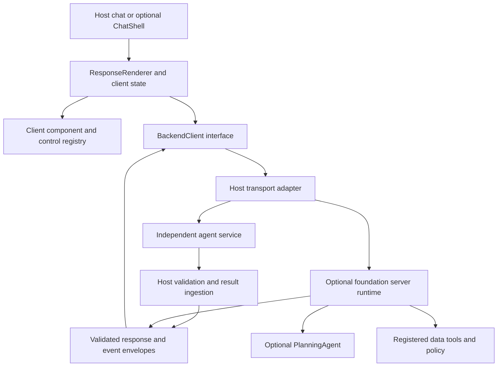

# V2 reusable chatbot and visualization foundation

Design revision: 2026-11-16.

## 1. Purpose and assessment

The goal is to reuse the conversation UI and data visualization components across independently implemented agent backends, and to embed the visualization capability inside an existing chatbot. A new integration should normally implement an adapter and register domain capabilities, without editing the chat shell, component library, core contracts or global planner prompt.

The v2 foundation now has a separate experimental reference path from browser through backend, including materialized responses, precomputed-result ingestion, registered renderers, scoped controls and SQLite-backed restoration/replay. The default application remains v1. The v2 release is not complete: action types, a stable package and acceptance evaluations remain open, as recorded in the implementation progress log.

This document defines the target design and migration acceptance criteria. Sections describing target interfaces and behavior are **proposed**, unless the implementation inventory explicitly says they exist. Updating this design does not change the running application.

“Generic” means extensible through documented contracts. It does not mean an arbitrary backend protocol or arbitrary model output will render without an adapter. The initial supported client stack is React/TypeScript; the wire format must remain language-independent. Non-React renderers can consume the same protocol later, but are not an initial delivery requirement.

### Success conditions

- Swap an agent backend through adapter configuration while preserving the rendered conversation and interaction behavior.
- Embed a single visual response into a host chat without adopting our server, planner, history storage or full-screen shell.
- Mount the optional shell with a host-supplied backend client, authentication and branding.
- Add a domain or supported component through registration, with no domain branch in core code.
- Preserve text-only replies, clarification, inline visual groups, expansion, exact-value inspection, interaction, cancellation, recovery and authorized restoration.
- Make unsupported capabilities, missing data and unavailable operations understandable to users.

### Initial scope boundaries

The foundation supplies presentation contracts and optional orchestration. It does not replace an agent framework, authentication provider, data warehouse or business workflow engine. Arbitrary generated JavaScript, HTML execution and model-selected remote modules are excluded. Write operations such as approving a transaction require a separate host action extension and explicit authorization semantics; initial built-in actions concern visualization and exploration.

## 2. Current implementation and gaps

| Area             | Existing implementation                                                                                                                                      | Remaining work                                                                                     |
| ---------------- | ------------------------------------------------------------------------------------------------------------------------------------------------------------ | -------------------------------------------------------------------------------------------------- |
| Contracts        | V2 plans, materialized snapshots, full 10-event taxonomy, negotiation, options, replay, semver/compatibility policy, and non-TS Python wire fixtures/validator | Frozen v1 coexistence continues for legacy `/` route                                               |
| Registry         | Versioned components, controls, tools, option resolvers, generic `registerAction` (`ui.sort`, `ui.paginate`, `ui.refresh`, `ui.setControl`, `ui.retryBinding`), `Policy.visibleField` + `fieldProjectionSafe` | Domain connectors beyond bundled examples are host-supplied                                        |
| Components       | Role-based core, project, statistical and geographic renderers; formatted values, record selection, `:focus-visible`, expansion, mobile/zoom & Axe WCAG 2.1 AA | Manual human screen-reader walkthrough (NVDA/VoiceOver); host-supplied custom geographic assets    |
| Execution        | Authorized execution/ingestion, partial results, multi-binding scoped retry, `change-answer` new revisions, `dependentPolicy`, semantic prose/grain validation, multi-worker leases & retention purge | Durable multi-region store scaling left to host DB adapter when replacing reference SQLite        |
| Planning         | Provider-independent planner, DeepSeek transport, prior-plan/clarification context, and 90-run 3-domain held-out evaluation (97.8%)                            | None in foundation contracts                                                                       |
| Client           | Injected `ChatShell`, `ResponseRenderer`, `FoundationHttpClient`, full event stream reducer, and compiled ESM + `.d.ts` `.tgz` distribution                  | None in foundation contracts                                                                       |
| Domain isolation | CSV definitions separated in `examples/csv-analytics`; 16-module import boundary guard; external consumer verified in isolated temp dir                        | None in foundation contracts                                                                       |
| Evidence         | Unit (92), integration (81), deterministic/spike/foundation/live E2E (27), Python wire/CSV oracles, 100-iter benchmark, compiled tarball consumer, 90-run heldout | Manual human screen-reader sign-off                                                                |

The source import guard currently covers sixteen foundation modules. It is useful evidence of those modules' isolation, not proof that the whole application is decoupled. A source package can be staged for TypeScript-aware consumers, but it is experimental and has not been released. See [implementation progress](IMPLEMENTATION_PROGRESS.md) for test evidence and limitations that supersede earlier checkpoints.

## 3. Architecture and ownership



| Owner                | Responsibilities                                                                                                                 |
| -------------------- | -------------------------------------------------------------------------------------------------------------------------------- |
| Host application     | Authentication, identity, conversation ownership, retention, deployment, branding, locale and permissions                        |
| Backend adapter      | Translate requests, events, errors, history and actions; negotiate capabilities; preserve cancellation and idempotency semantics |
| Agent service        | Reasoning, tool orchestration and candidate presentation selection, using advertised capabilities                                |
| Validation authority | Validate plans/results and policy before publishing; never trust a model's identity, permissions or provenance claims            |
| Optional runtime     | Plan repair, tool execution, action coordination, response materialization and storage through interfaces                        |
| Client runtime       | Event ordering, reconnect state, pending operations and immutable response snapshots                                             |
| Renderer             | Render validated blocks and data; emit typed user intents; manage layout, expansion and accessible inspection                    |
| Domain extension     | Business definitions, tool schemas, data semantics, option resolvers and record navigation                                       |

Import direction is contracts → registries/adapters → runtime or renderer → host composition. Contracts contain no React, filesystem, database, provider SDK or domain dependency. Browser entry points must never transitively import tool executors, credentials, server policy implementation or database code. Client descriptors and server executors have separate entry points. Applications may import core packages; core packages may not import applications or examples.

## 4. Three supported integration modes

### A. Embed rendering in an existing chat

The host supplies a validated materialized response and action callbacks to `ResponseRenderer`. It owns conversation state and transport. Static read-only rendering requires no backend client. Interactive rendering requires only the operations advertised for that response. A host may render a single visual block instead of the entire response.

### B. Use the shell with an independent backend

The host mounts `ChatShell` with a `BackendClient`, renderer registry and presentation configuration. The adapter translates the remote service into the foundation protocol. The service can use any language, model, orchestration framework or storage engine. Foundation tool execution and DeepSeek are optional.

### C. Use the supplied server runtime

The host registers domains, tools, policy and storage, and supplies a `PlanningAgent`. The runtime validates candidates, executes tools and publishes materialized responses. The included capability planner and DeepSeek transport are optional implementations of this mode.

All three modes share rendering and data semantics. Modes B and C share client lifecycle contracts. Adapters declare unavailable operations rather than returning misleading successful no-ops.

## 5. Presentation contract

### Existing ResponsePlan

Retain the existing v2 design:

- `schemaVersion: 2` and `capabilitySnapshotId` bind the proposal to a capability set.
- `bindings` identify data operations and initial arguments.
- Ordered `blocks` contain text, clarification or visual content.
- Visual blocks contain elements with versioned component references, named field roles and validated properties.
- Facts reference binding fields and rows; text contains literal parts or fact tokens.
- Controls target explicit binding arguments and declare their purpose and scope behavior.

Ordinary charts and metrics remain together in one response group. Dense diagrams can occupy separate visual blocks. Block order represents presentation order, never a dependency between business tasks. The frontend decides responsive placement within the declared intent. Stable message and block IDs preserve grouping through reload.

### Materialized response

Introduce a serializable response envelope distinct from a planner proposal. It includes:

| Field                     | Meaning                                                                                     |
| ------------------------- | ------------------------------------------------------------------------------------------- |
| `protocolVersion`         | Lifecycle/wire version, separate from plan schema version                                   |
| `messageId`, `responseId` | Stable host conversation attachment and response identities                                 |
| `revision`, `generation`  | Accepted semantic plan version and data/view execution version                              |
| `plan`                    | Canonical validated ResponsePlan                                                            |
| `bindingDescriptors`      | Authorized field definitions, grain and supported interaction metadata needed for rendering |
| `datasets`                | Binding-keyed pending, ready or failed states, with validated DataResult when ready         |
| `facts`                   | Materialized fact tokens with source references and formatting metadata                     |
| `operations`              | Allowed actions for this response, including read-only status and constraints               |
| `status`, `diagnostics`   | Execution state and safe structured diagnostics                                             |

The initial Zod schema is implemented in `packages/contracts/protocol.ts`, but is not yet a released compatibility commitment. It retains field descriptors and connector-owned result annotations so supported responses can render without fetching the live catalog. Unknown component versions produce an unsupported-element state and an exact-values fallback when data is authorized. Operation constraints and the full lifecycle taxonomy remain incomplete.

A ready result and its facts must refer to the same generation. Model-generated text is not proof of a numerical claim. Structured fact tokens are grounded, while literal prose still requires agent guidance and semantic evaluation.

## 6. Data contracts and independent result ingestion

Retain explicit field IDs, labels, scalar types, null semantics, units, measure definitions and temporal metadata. `DataResult` carries rows and provenance: source ID/version, query ID, execution time, optional source reporting period, grain, truncation, cursor and warnings. The materialized envelope adds field descriptors because today's DataResult does not contain them.

Do not infer business meaning from names such as `month_id`, `sla_mean`, `domain` or `rowId`. Units, timezone, precision, aggregation and denominator come from registered metadata. Missing observations remain missing. Currency conversion, weighted averages and cross-source joins require an explicit validated data operation. Same-unit/same-grain rules prevent incompatible chart combinations. Partitions, intervals, graph edges, project dependencies and geography need component-specific semantic validation beyond scalar field types.

### Ingestion path

Independent agents may already execute queries. `FoundationRuntime.ingest` accepts precomputed results through registered tool-compatible sources, then applies registered projection, annotation, component-semantic and policy checks. The trusted host remains responsible for establishing result ownership and authentic provenance; this API does not prove those claims itself.

1. The trusted host adapter establishes a scoped result-source descriptor with fields, grain, operation schema and supported interactions.
2. It ingests precomputed results against that descriptor, associating them with the authenticated conversation and execution context.
3. The backend validation authority checks size, field types, projection, semantic invariants, ownership and provenance supplied by the trusted connector.
4. A candidate plan references those registered bindings and is validated against available component descriptors.
5. The authority publishes a materialized response through the same envelope as framework-executed results.

Initially represent imported bindings through host-registered result sources compatible with tool capability references. Add an explicit binding variant only if the implementation gate demonstrates that this cannot preserve semantics cleanly. Do not weaken validation to accept arbitrary data blobs or invent a tool per row.

Imported snapshots can be read-only. Interactive imported results advertise a host resolver that can execute a new query. A refresh never fabricates fresh data from a static snapshot. Submitted user content may be a source, but the resulting provenance must distinguish supplied facts, model interpretations and assumptions from connector-verified values.

## 7. Backend client and embedding APIs

Experimental React entry points (public package exports and compatibility guarantees remain a delivery gate):

```ts
// Conceptual signatures; supporting types are to be formalized in contracts.
<ResponseRenderer response={response} registry={registry}
  onAction={handleAction} presentation={presentation} />

<ChatShell client={backendClient} registry={registry}
  presentation={presentation} />
```

`ResponseRenderer` performs no hidden HTTP calls and has no conversation persistence dependency. Exact-value inspection and expansion are local UI actions. Record navigation is a host callback using a declared identifier field, not a hardcoded endpoint or `rowId` assumption.

The proposed `BackendClient` provides:

| Operation         | Behavior                                                                                                                          |
| ----------------- | --------------------------------------------------------------------------------------------------------------------------------- |
| `negotiate`       | Return protocol/component versions, limits and supported operations                                                               |
| `sendTurn`        | Accept conversation/message IDs, user input, prior response references, idempotency key and abort signal; yield normalized events |
| `dispatchAction`  | Accept revision/generation target, action reference, payload and idempotency key; yield normalized update events                  |
| `getConversation` | Restore authorized messages and referenced response snapshots when history is supported                                           |
| `resumeRequest`   | Replay after a cursor or return a durable snapshot when resumability is supported                                                 |
| `cancelRequest`   | Request server-side cancellation; distinguish acknowledgement from terminal cancellation                                          |
| `resolveOptions`  | Resolve authorized control choices with search/pagination where supported                                                         |

Optional methods are gated by negotiated capabilities. Authentication is injected into the transport by the host. The shell does not read credentials or choose a backend URL. HTTP/SSE is the initial adapter; a host can implement an in-process or WebSocket adapter with identical observable behavior.

Presentation configuration owns labels, suggestions, branding, locale, timezone, number formatting, provenance labels and record navigation. No CSV-specific localStorage key, provider badge, source-record wording or hardcoded business footnote remains in reusable UI. The host selects persistence identity and conversation IDs.

## 8. Streaming, revisions and recovery

Define a v2 event envelope with protocol version, unique event ID, request ID, monotonically increasing per-request sequence, conversation/message IDs and typed payload. Artifact-related events additionally carry response ID, revision and generation. Proposed events cover request start, text delta, plan acceptance, binding pending/ready/failure, atomic response commit and request completed/failed/cancelled.

The event schema must validate payloads by event type. Sequence deduplication is scoped to a request. The client rejects stale generations and mismatched response targets. A connection closing without a terminal event is interrupted, not successful. Transport framing is adapter-owned; the reducer consumes normalized events.

A revision changes the semantic answer or plan. A generation updates data or the view within that revision. Historical message attachments refer to immutable committed snapshots. A scope-changing control creates a new revision and explicit transcript context; ordinary filtering within an answer creates a new generation. Pending changes do not overwrite the last good snapshot.

Stage datasets and fact values until an atomic generation commit. A partial commit may contain independent successful bindings and explicit failures, but never label stale data as current. Grouping by visual block must not produce multiple conflicting copies of the same response state.

The server serializes conflicting changes or rejects an outdated base revision/generation. Idempotency keys are bound to operation, identity and payload; reusing a key with different content is an error. Cancellation is best effort during execution, but cancelled or superseded work must not later publish a successful commit.

Persist replay events for a declared retention window. An expired cursor returns a typed replay-expired outcome and a snapshot recovery route. Adapters that cannot replay advertise this and provide snapshot recovery or a visible interrupted state. Do not simulate durable cancellation or replay only in browser memory.

## 9. Controls and actions

Existing validation fixes all arguments by default. Only declared `within-answer` controls make owned arguments editable. `change-answer` controls explicitly alter fixed scope. Initial values must equal the effective initial query; argument ownership cannot overlap; dependencies must be acyclic and within the declared block. These invariants remain.

Implement registered action and option resolvers. Each registration defines versioned identity, payload/value schema, eligible targets, execution owner, capability requirements and side effects. Initial actions cover control changes, sort, pagination, refresh and scoped retry. Saved views are optional host persistence operations. Clarification choices submit a typed reply through the host conversation flow.

Options are resolved server-side using current authorized scope and other effective arguments. Revalidate selected values on execution, including dependent-control changes. Define whether an invalid dependent selection is reset or rejected; return that decision explicitly with the canonical state. The client never silently broadens scope.

Local sort/filter is allowed only when advertised and the complete authorized result is present. Otherwise the adapter dispatches to the backend. Changing filter/sort state invalidates incompatible pagination cursors. Ordinary exploration does not require a new model call; an adapter may use its agent internally, but this is not a frontend dependency.

For concurrent changes, retain the previous committed view, show pending state and accept only the server-approved generation. Failed actions retain the prior view with a retryable diagnostic. Historical views are read-only unless the host explicitly forks them into a current response.

## 10. Component registry and rendering

Separate serializable component descriptors from client implementations. Both use the same capability ID/version and are verified for conformance. Descriptors define roles, property schemas, semantic requirements, layout constraints, guidance, interaction support and accessible fallback behavior. Client registrations provide the React implementation and optional OpenUI mapping.

Capability negotiation advertises the intersection of server-approved and client-installed versions. The agent must not choose an unavailable renderer. Unknown versions in restored history must not silently map to the newest renderer. Extensions are host-installed trusted code, never executable content fetched from a model-supplied URL.

Port existing chart implementations using role-to-field adapters rather than rewriting their SVG rendering. Remove field-name defaults and business wording. Advertise only functional components: the current relationship placeholder does not qualify as a working graph renderer. Specialized chart contracts must preserve their existing validation requirements during migration.

The renderer supports ordered blocks, adaptive widths, compact single charts, grouped ordinary panels, dedicated space for dense diagrams, expansion dialogs, loading/empty/error states and exact-value tables. It uses stable IDs for state and focus. All interactions require accessible names, keyboard operation and visible focus; charts need textual summaries and accessible underlying values. Color must not be the sole encoding. Host locale/timezone controls display without changing source values.

OpenUI remains an implementation adapter. Plan data must not encode OpenUI programs. A direct React renderer and OpenUI-backed renderer must interpret the same validated element semantics.

## 11. Policy, storage and operational boundaries

The host authenticates principals; model plans cannot provide identity or permission context. Discovery is scoped, and every query, option resolution, action, restoration and imported-result publication rechecks policy. Authorized capability discovery alone is not execution authorization. Field-level policy (`Policy.visibleField` paired with `ToolRegistration.fieldProjectionSafe`) must constrain descriptors, snapshot capability invalidation tokens, execution/reauthorization scope identities, and returned projections including exact-value tables and tool samples. Hosts enabling `fieldProjectionSafe: true` are responsible for ensuring tool descriptions, arguments, provenance, `resultAnnotations`, and option resolvers do not leak hidden field names or derived values.

Keep the existing before/after execution authorization check. Bind caches to effective arguments, tool version, source version, authorized scope and policy epoch. Cross-tenant cache sharing requires explicit safe semantics. Permission revocation prevents cached history and replay from exposing stale-authorized data.

Define a storage interface for conversations, immutable response snapshots, request/idempotency state, events and optional saved views. SQLite is a reference adapter. External backends can own all persistence. Stored records retain protocol/schema/component versions, field descriptors and source provenance. Pure explicit migrations or a legacy reader handle v1; never reinterpret a v1 snapshot as v2 by changing its version field.

Budgets cover serialized plan/result bytes, elements, bindings, controls, rows, concurrent queries, deadlines and repair attempts. Existing catalog defaults are 65,536 bytes, six bindings/elements/controls and 2,000 rows; schema ceilings are not deployment defaults. Enforce budgets on ingestion, execution and transport, with understandable partial-result or simplification outcomes. Large results require aggregation, paging or bounded sampling with clear labels.

Extend diagnostics with stable codes for transport interruption, revision conflict, replay expiry, unsupported version, source failure and authentication expiry. Errors include safe messages, retryability and target IDs without raw secrets or unauthorized values. Trace request, response, generation, binding and adapter IDs; record validation failures and timings. Raw prompts, source data and credentials are excluded from default logs.

## 12. Agent integration

The existing `PlanningAgent.propose(context)` is a useful optional server interface. Preserve provider independence and generated capability guidance. Independent services may instead submit candidate plans plus validated results through ingestion.

The planner receives authorized descriptors, relevant conversation context and explicit previous-response references. The host context adapter controls history selection and redaction. No browser code calls a provider directly. The included planner currently sees a capability snapshot and does not perform exploratory discovery; future sample/discovery tools must be scoped and budgeted.

Validation errors permit bounded repair, currently one repair by default. Exhaustion produces a useful clarification or structured failure. Do not substitute demo data. Explicit supported chart requests should be honored; unsupported or semantically inappropriate choices require explanation. Plans remain complete descriptions of a new reply rather than unvalidated mutations of historical content.

## 13. Migration and delivery gates

This sequence refines G02–G13 in `GENERAL_CHATBOT_UI_FOUNDATION_PLAN.md`. Track execution evidence in `IMPLEMENTATION_PROGRESS.md`; none of the target gates below is claimed complete by this document.

| Gate                              | Deliverable                                                                                                 | Required exit evidence                                                                                                           |
| --------------------------------- | ----------------------------------------------------------------------------------------------------------- | -------------------------------------------------------------------------------------------------------------------------------- |
| M1: public contracts              | Materialized response, ingestion descriptors, event schemas, negotiation, backend client and error taxonomy | Serialized fixtures for text, clarification, visuals, partial failure and imported data; non-TypeScript wire consumer validation |
| M2: renderer extraction           | V2 ResponseRenderer, client registry, host presentation config; port current working charts                 | Same chart values and semantics as v1; no transport/domain imports; unsupported-version fallback and accessibility checks        |
| M3: shell and transport           | Export ChatShell, injected BackendClient, HTTP/SSE reference adapter, normalized reducer                    | Text → visual → cancel/recover → reload through adapter; no direct fetch in reusable UI                                          |
| M4: generic actions               | Scoped options, controls, sort/page/refresh/retry, conflict handling and generation commits                 | Select/multi-select/date-range flows across two unrelated domains; stale updates and scope changes tested                        |
| M5: persistence and compatibility | Storage interface, snapshots/replay, v1 reader and policy rechecks                                          | Frozen v1 restoration plus v2 restart/replay/revocation tests; existing histories preserved                                      |
| M6: independent integration       | Separate backend using precomputed result ingestion and another transport implementation                    | Same shell works with backend-owned tools/history; read-only embedding works without foundation server                           |
| M7: consumer release              | Public exports, browser/server entry points, styles/theme API, integration guide and compatibility policy   | Clean consumer builds using package exports only; held-out domain and component need no core edits                               |

Use an explicit v1/v2 feature boundary during migration. Preserve the current application until the new route passes equivalent journeys. A temporary v1-to-v2 adapter must document unsupported features; it is not proof of a native v2 backend integration. Move one vertical slice through all layers early: text, one chart, one control and reload. Then port the remaining components and specialized semantics.

## 14. Acceptance and evidence

### Reuse tests

1. An existing host chat renders a read-only response using only contracts, renderer and styles.
2. An independent backend owns reasoning, tool execution and storage; the shell uses its adapter without importing the reference server.
3. Both framework-executed and ingested data produce equivalent rendered values and interactions.
4. A new domain with different field names, units, identifiers and filter dimensions requires only registrations and host configuration.
5. A new component/control pair is installed through public registries without modifying a core discriminated union, renderer switch or planner prompt list.
6. The external consumer uses package exports, not relative imports into repository source.

### Behavioral tests

Cover text-only and mixed responses, clarification, grouped/dense visuals, missing/empty data, mismatched units, misleading partitions, unsupported versions, truncated data, action races, stale generations, cancellation, interrupted streams, replay expiry, duplicate requests and restoration after restart. Use independent expected values for data assertions rather than duplicating production calculations in tests.

Run browser journeys through two unrelated domains and the independent backend, including filtering, pagination, source inspection and reload. Keep deterministic adapter tests distinct from live-model tests. Static contracts and scripted fixtures establish mechanics, not semantic generality.

### Isolation and product tests

Check public dependency graphs and actual browser bundles for server imports. Verify tenant/field restrictions across options, cache, history and exact-value views. Test supported widths, 200% zoom, keyboard/focus behavior and automated accessibility; record manual screen-reader review separately. Measure payload size, render time and action latency on representative bounded datasets before setting performance acceptance thresholds.

Use the held-out prompt and extension evaluation from the general foundation plan to assess actual agent decisions. Report first-pass validity, repair rate, semantic correctness and unsupported cases. A structural schema pass cannot establish that a visualization answers the question.

### Existing evidence and commands

Existing tests cover multi-domain contracts/execution, renamed fields, mixed units, authorization changes, bounded repair, real CSV execution and frozen legacy restoration. Recorded DeepSeek foundation smoke tests are backend-to-provider-to-tool tests, not v2 browser evidence. The 2026-11-15 assessment ran 30 targeted client/foundation tests and the foundation import guard successfully; it did not validate an alternate backend browser flow.

Relevant repository checks as implementation proceeds:

```powershell
pnpm typecheck
pnpm check:foundation
pnpm test:unit
pnpm test:integration
pnpm build
pnpm test:e2e:deterministic
pnpm test:spike
# External provider smoke test, under the configured data-sharing scope:
pnpm test:foundation:live
```

Extend these checks with backend-client conformance, independent ingestion, public consumer and v2 browser suites as their implementations land.

## 15. Defaults and remaining product decisions

Proceed with React/TypeScript clients, JSON wire contracts, HTTP/SSE as the reference transport, optional OpenUI rendering, optional SQLite storage and optional DeepSeek planning. Preserve conversation-first presentation and keep normal charts grouped, with expansion for complex content. Require a backend adapter for incompatible external protocols.

No clarification is needed to implement these architectural boundaries. The first real external integration will need its API/authentication details and a decision about whether it or the host owns conversation storage. Packaging destination, production identity/retention policy and non-React support can be decided at their respective delivery gates without blocking the foundation extraction.

Related documents: [general foundation plan](GENERAL_CHATBOT_UI_FOUNDATION_PLAN.md), [migration baseline](FOUNDATION_MIGRATION_BASELINE.md), [implementation progress](IMPLEMENTATION_PROGRESS.md), and [visualization scope](DATA_VISUALIZATION_IMPLEMENTATION.md).
